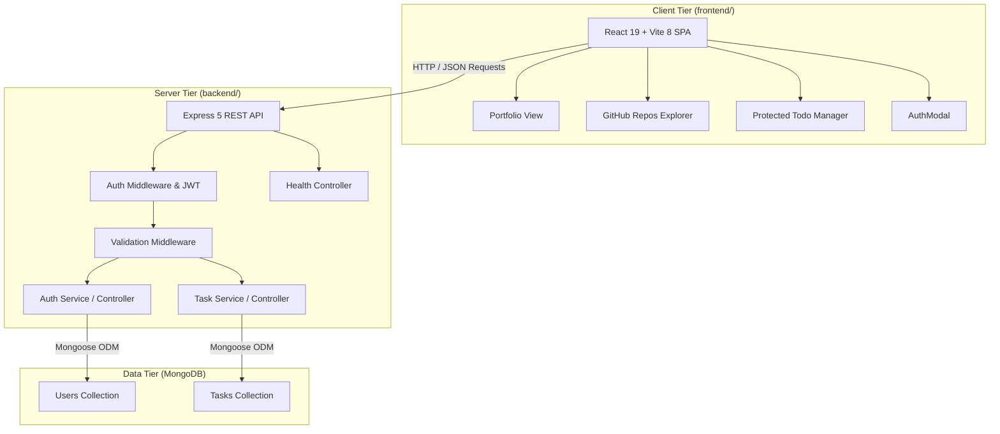
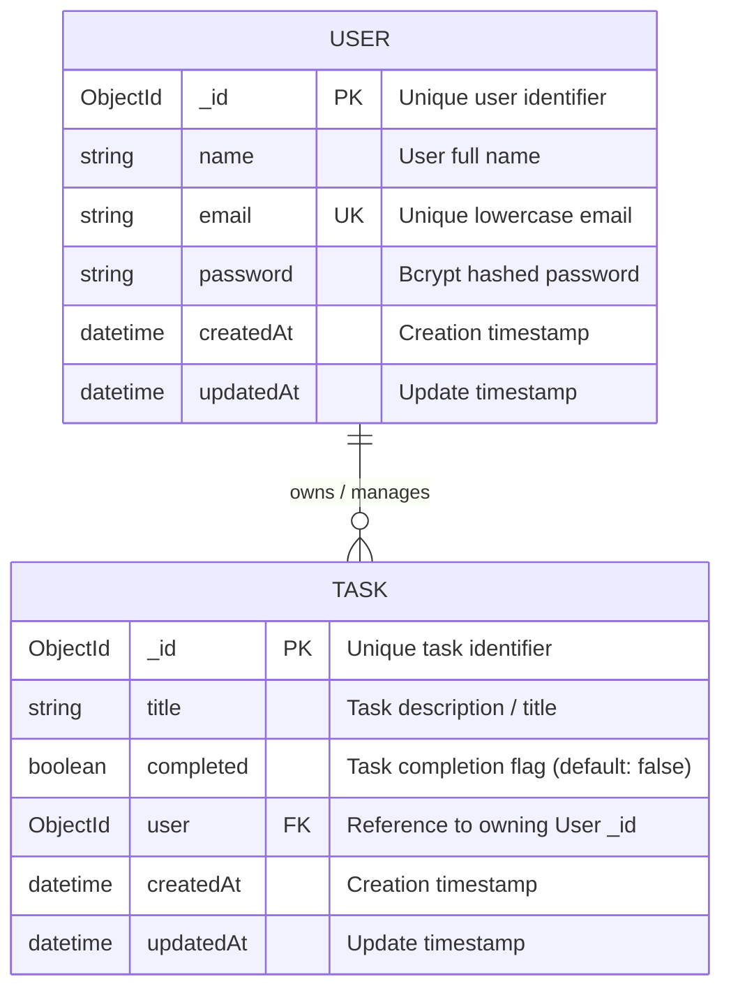
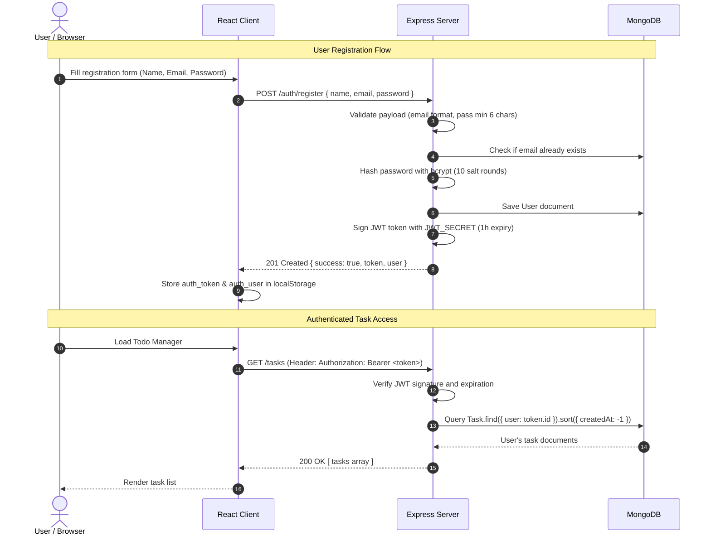

# AWDF Architecture & Design Specification

## 1. System Overview

The AWDF platform is a decoupled, modern full-stack web application designed for developer portfolio presentation and private task management with user authentication.



---

## 2. Database Schema & Data Model (ERD)



### Database Indices:
- **`User.email`**: Unique index (`{ email: 1 }`), ensuring zero duplicate email registrations.
- **`Task.user` & `Task.createdAt`**: Compound index (`{ user: 1, createdAt: -1 }`), guaranteeing index-covered sorting and instantaneous task retrieval for each user.

---

## 3. Authentication & Authorization Sequence



---

## 4. Strict User Isolation Guarantees

1. **No Cross-User Leaks**: Every CRUD operation against tasks explicitly requires the `user` field matching `req.user.id` decoded from the valid JWT:
   ```js
   const task = await Task.findOne({ _id: taskId, user: req.user.id });
   ```
2. **Resource Concealment (404 instead of 403)**: If User A attempts to view, modify, or delete a task belonging to User B, the server responds with `404 Not Found`, giving zero information about the existence of other users' tasks.
3. **No Unhashed Passwords**: Passwords never enter the database in plaintext. Passwords are automatically stripped before sending JSON responses back to the client.
